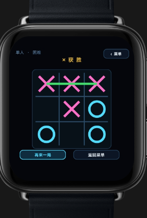
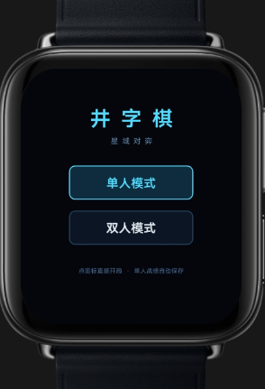
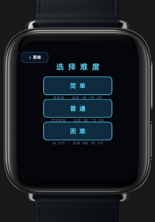

# 井字棋 Tic-Tac-Toe ⌚

一款为智能手表打造的井字棋小游戏（vivo 手表快应用）。经典 X / O 对战搬上表盘，霓虹发光配色 + 黑底表盘，好看又耐玩。

## 游戏截图

| 主菜单 | 选择难度 | 对战胜利 |
|:---:|:---:|:---:|
|  |  |  |

## 玩法特色

- **单人模式**：内置 AI 对手，简单 / 普通 / 困难三档难度，从新手陪练到步步紧逼，任你挑
- **双人模式**：和朋友共用同一块手表，轮流落子一决胜负
- **进度保存**：简单模式可开启，单人进度自动保存，随时接着玩
- **手表优化**：大按钮、大棋盘，专为小屏幕触控设计，旋转表冠即可退出

## 下载安装

在手机或手表的快应用环境中打开本仓库的 [com.sci.ttt.debug.production.1.0.0.rpk](com.sci.ttt.debug.production.1.0.0.rpk) 即可安装（调试签名包，v1.0.0）。

---

*X 赢了，该你了。*
